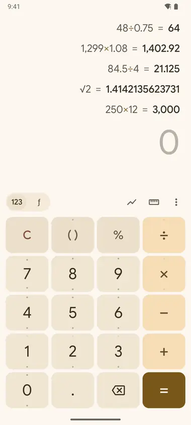
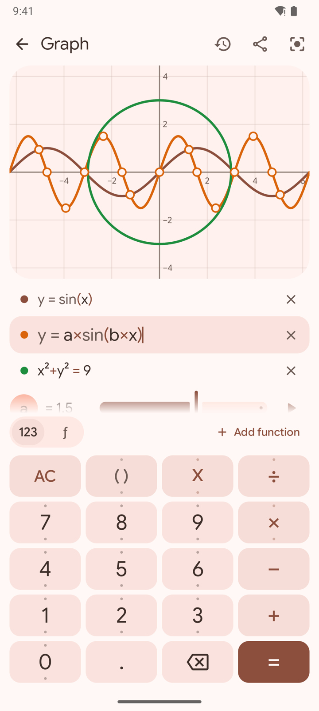
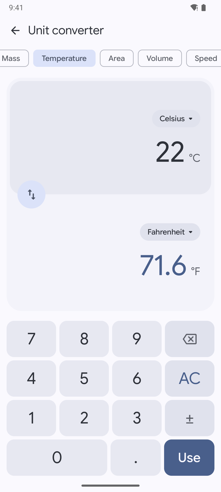
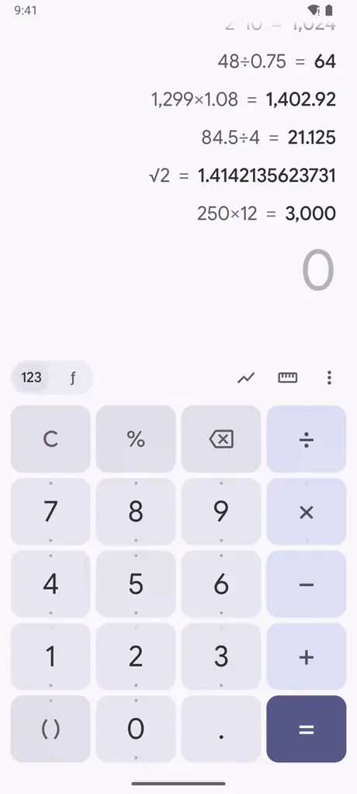

  

<h1 align="center">Calcula</h1>

<b>Flick a key. Get a function.</b>

  A calm, exact calculator. Every key carries two more functions, named right on it: flick up or down to reach them. 
  No menus to dig through, no second screen of buttons.

  

  <a href="https://github.com/bernaferrari/android-calculatorpp/releases"><b>Download</b></a>

## Why people like it

- **Functions under your thumb.** sin, log, √, x², π and more live on the digits, each named on its key. Flick up for one, down for the other, hold to see both. Reach for one that can't apply yet and it shakes its head.
- **Or flip the whole keypad.** Tap **ƒ** and the keys turn into functions for one press, or hold it to keep them. Functions that would do nothing yet are dimmed.
- **Exact answers.** 0.1 + 0.2 is 0.3. Smart percent: 200 + 10% is 220.
- **A history you'll actually use.** Past results stay above the keys. Tap one to reuse it, pull down to see them all.
- **Graphs that teach.** Up to six functions, sliders for a, b, c, d, roots and turns you can tap. Recent graphs are kept, and any one shares as an image.
- **A unit converter, one tap away.** Length, mass, temperature, data and more, with exact factors.
- **Edits like text.** Double-tap to select, then wrap it in parentheses or √ with one key. Copy and paste work like everywhere else.
- **Quiets down as you learn.** Once you've flicked a few times, the names on the keys give way to small dots. Prefer the names, the dots or nothing at all? It's one setting.
- **Yours to shape.** Light or dark, ten color families or your wallpaper's, each in four moods from muted to playful.
- **Big screens too.** On tablets and foldables, your history gets its own pane beside the keys.

## Beyond the keypad

| Explore functions | Convert units |
| :---: | :---: |
|  |  |
| Plot functions and inspect roots and turning points. | Convert temperatures, lengths, masses, and more. |

## Once you know your way around

After a few flicks the keypad trades its names for two small dots on each key, the same gestures with less to read.

  

## Private by design

No ads, no accounts, no tracking. Your calculations never leave your device.

## Where it comes from

Calcula grows out of [Calculator++](https://github.com/serso/android-calculatorpp), the swipe-key calculator Sergey Solovyev started in 2011. Its best idea, that a key can hold more than one thing, is still at the heart of it; everything else is rebuilt from scratch, for Android, iOS and the web.

Found a bug or have an idea? [Open an issue](https://github.com/bernaferrari/android-calculatorpp/issues).
