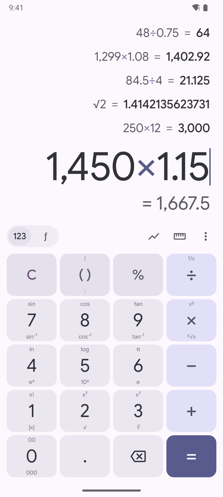
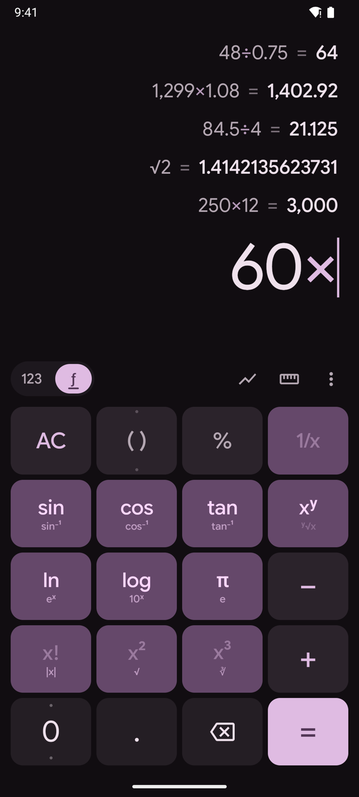
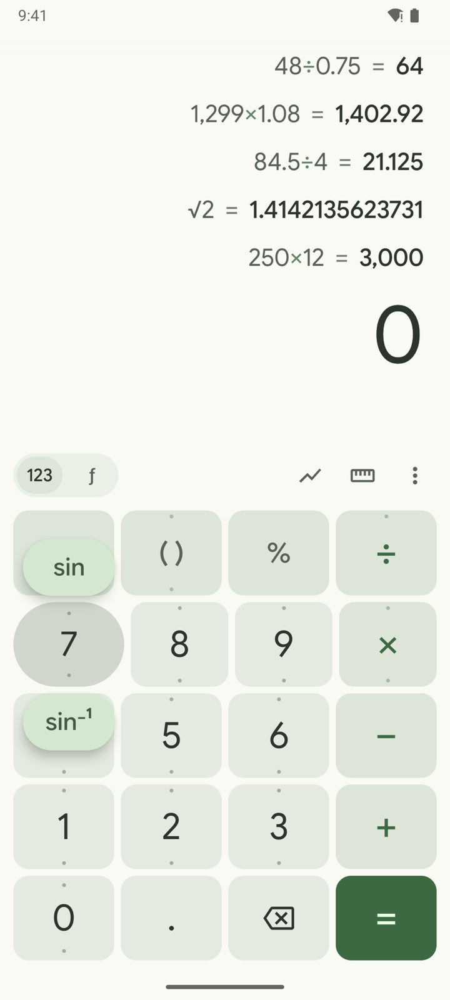
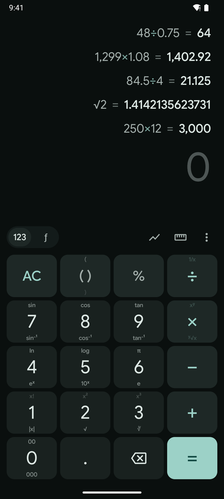
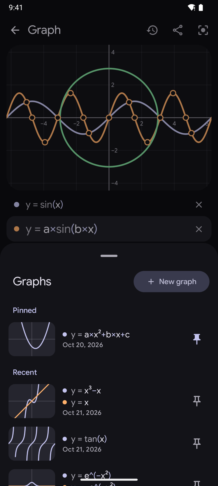
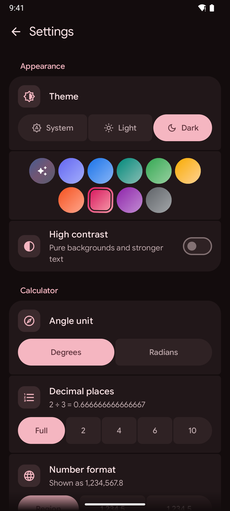
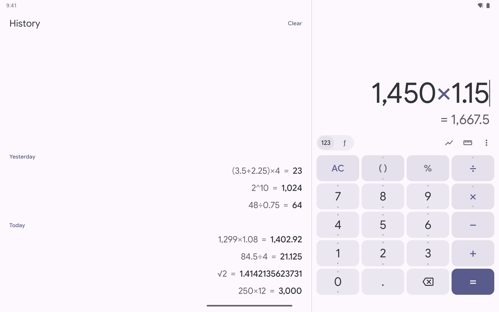

# Calcula

A scientific calculator for Android, iOS and the web, built with Compose Multiplatform and Material 3 Expressive. A modern rebuild of Calculator++ ([serso/android-calculatorpp](https://github.com/serso/android-calculatorpp)).

<p align="center">
  
  
  
  
</p>
<p align="center">
  
  
  
  
</p>
<p align="center">
  
</p>

## What makes it Calcula

- **Flick keys.** Swipe a key up or down for its second and third functions (sin, cos, √, x², …); hold a key to see both. Small dots mark the keys that have them.
- **123 / ƒ.** One tap flips the keypad to a full function layer, once or locked.
- **Paper tape.** Past calculations sit above the live entry; open history for days, swipe to delete, tap to reuse.
- **Exact arithmetic.** A 40-digit decimal engine: `0.1 + 0.2 = 0.3`, smart percent (`200 + 10%` = 220), implicit multiplication, auto-closed parentheses.
- **Unit converter.** Exact definitions across ten categories. It opens with the calculator's current number, and **Use** sends the converted value back.
- **Graphs.** Up to six functions or equations in x and y, sliders for a–d, tap-to-read key points and a trace. Recent graphs are kept (pin the ones you want), and any graph shares as an image.
- **Edits like text.** Double-tap to select, hold for all; copy, cut and paste. A selection wraps in `( )`, √ or any function with one key.
- **Hints your way.** Keys show their flick functions as labels, dots or nothing; functions that would do nothing right now are dimmed.
- **Any screen.** On tablets, foldables and wide browser windows, history gets its own pane beside the calculator.

## Modules

- `shared`: everything: engine, input rules, UI, storage. Targets Android, iOS (arm64 and simulator) and wasmJs.
- `androidApp`: Android host (`com.bernaferrari.calcula`).
- `iosApp`: Xcode host project.
- `webApp`: browser host (Kotlin/Wasm).

## Build and run

Android:

```bash
./gradlew :androidApp:installDebug
```

Web: build, then serve `webApp/build/dist/wasmJs/productionExecutable` with any static server:

```bash
./gradlew :webApp:wasmJsBrowserDistribution
```

Or a live development server:

```bash
./gradlew :webApp:wasmJsBrowserDevelopmentRun
```

iOS: open `iosApp/iosApp.xcodeproj` and run the `iosApp` scheme. The Xcode build phase calls `:shared:embedAndSignAppleFrameworkForXcode`.

Tests (shared code, on the JVM and the iOS simulator):

```bash
./gradlew :shared:testAndroidHostTest :shared:iosSimulatorArm64Test
```

## Git remotes

- `origin`: your fork (`bernaferrari/android-calculatorpp`)
- `upstream`: original repo (`serso/android-calculatorpp`)
