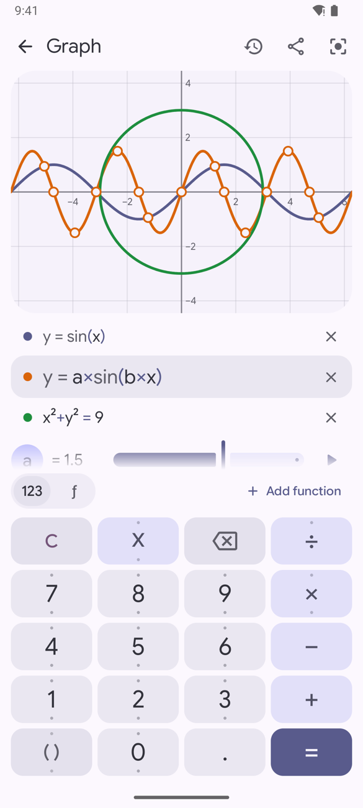
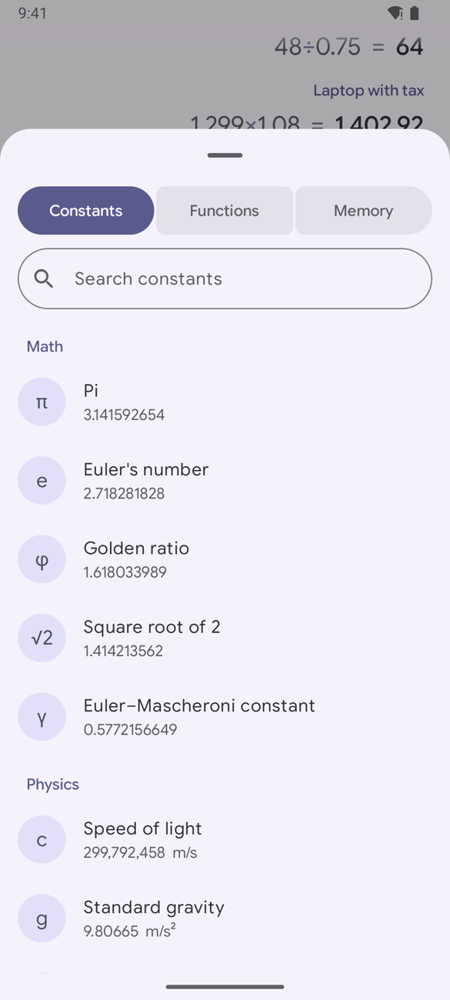
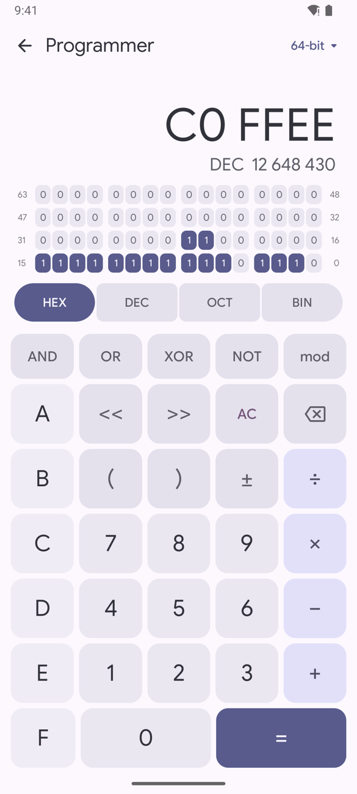
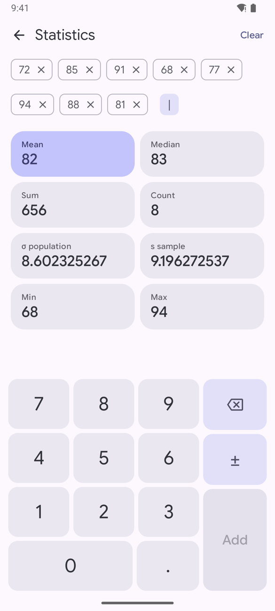

  

<h1 align="center">Calcula</h1>

<b>Flick a key. Get a function.</b>

  A calm, exact calculator for Android, iOS and the web. Every digit carries more: flick up for sin, log, x², π; flick down for their partners. 
  The functions are named right on the keys, so there's no second screen of buttons and nothing to dig for.

  

  <a href="https://github.com/bernaferrari/android-calculatorpp/releases"><b>Download</b></a>

## Why people like it

- **Functions under your thumb.** sin, cos, tan, ln, log, π, x², √ and more live on the digits. Each key names the function a flick up gives you; hold it to see both. Reach for one that can't apply yet and the key shakes its head.
- **Exact answers.** 0.1 + 0.2 is 0.3, not 0.30000000000000004. Smart percent: 200 + 10% is 220. When a result is a simple fraction it says so too: 0.375 is also 3/8.
- **A keypad you already know.** 0 under 2 like a phone's dial pad, backspace up top by the operators, parentheses in the corner. Tap the preview (= 52) to take it, like pressing =.
- **A history you'll actually use.** Past results stay above the keys. Tap one to reuse it, pull the bar down to see them all, add a note to any of them, share the lot as text.
- **Edits like text.** Double-tap to select, then wrap it in parentheses or √ with one key. Drag along the expression, or use ‹ ›, to move the cursor. Cleared something by mistake? Undo.
- **Quiets down as you learn.** After a few flicks the names step back to small dots. Prefer the names, the dots or nothing at all? One setting.
- **Yours to shape.** Light or dark, ten color families or your wallpaper's, each in four styles, previewed as the keypad itself. Drag the bar above the keys to make them bigger or smaller.
- **Big screens too.** On tablets and foldables your history gets its own pane beside the keys.

## Beyond the keypad

| Graph | Convert | Remember |
| :---: | :---: | :---: |
|  |  |  |
| Up to six functions and equations, sliders for a, b, c, d, roots and turns you can tap. Graphs are kept and share as images. | Length, mass, temperature, data and more, with exact factors. The number on screen comes along, and the answer goes back. | Every calculation by day. Notes on the ones that matter, and the whole list shares as text. |

## Once you know your way around

The names give way to two small dots per key: the same flicks, less to read. When you want every function in view, **ƒ** turns the digits into them for one press, or hold it to keep them; the ones that would do nothing yet are dimmed.

  

## For the ones who want more

Everything here is off by default or tucked in the ⋮ menu, so the calculator stays simple until you go looking.

| Library | Your own keys | Programmer |
| :---: | :---: | :---: |
|  |  |  |
| 28 constants of science (c, h, Nₐ, G…), functions you write yourself, and named memories. | Any flick can do anything: a built-in function, a constant, one of your functions, or nothing. | Hex, decimal, octal and binary, bitwise operators and shifts, 8 to 64 bits, every bit tappable. |

| Statistics | Styles | On your home screen |
| :---: | :---: | :---: |
|  |  |  |
| Type a list, get mean, median, σ and s, min and max. Tap any to use it. | Color families and four styles, each shown as the keypad it gives you. | Widgets on Android (the whole calculator) and iOS (your latest answer). |

And a few more:

- **Write your own functions.** `tip(x) = x×0.18`, then type `tip(` like `sin(`. They work in previews, in RPN and in the graph, and they can call each other.
- **Memory keys and RPN.** A slim MC · M+ · M− · MR row if you want it, and Reverse Polish entry with an open-ended stack: ↵ pushes, operators act at once, x⇄y and roll on the parentheses key.
- **Scientific and engineering notation.** 1.23×10⁶ or 12.3×10³, with the decimals you choose.
- **Siri and Shortcuts on iOS.** "Calculate with Calcula", then say it the way you'd say it: "15% of 80 plus 3 squared". The answer is spoken back and kept in your history.

## Private by design

No ads, no accounts, no tracking. Your calculations never leave your device.

## Where it comes from

Calcula grows out of [Calculator++](https://github.com/serso/android-calculatorpp), the swipe-key calculator Sergey Solovyev started in 2011. Its best idea, that a key can hold more than one thing, is still at the heart of it; everything else is rebuilt from scratch in Kotlin Multiplatform and Compose, for Android, iOS and the web.

Found a bug or have an idea? [Open an issue](https://github.com/bernaferrari/android-calculatorpp/issues).
